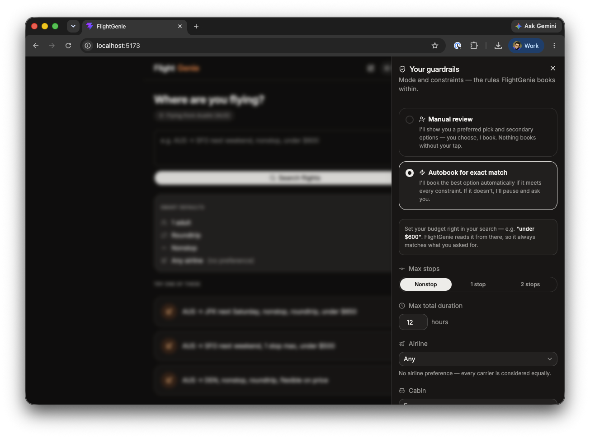
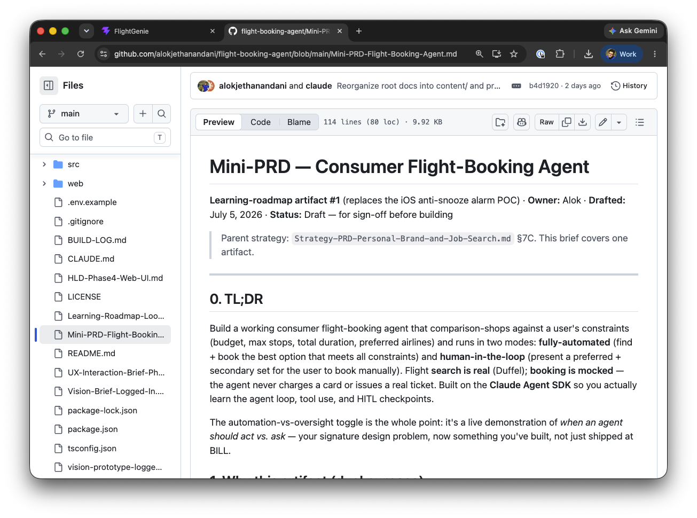
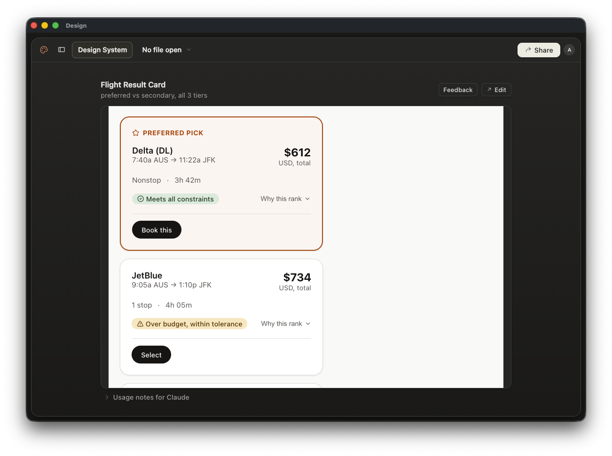
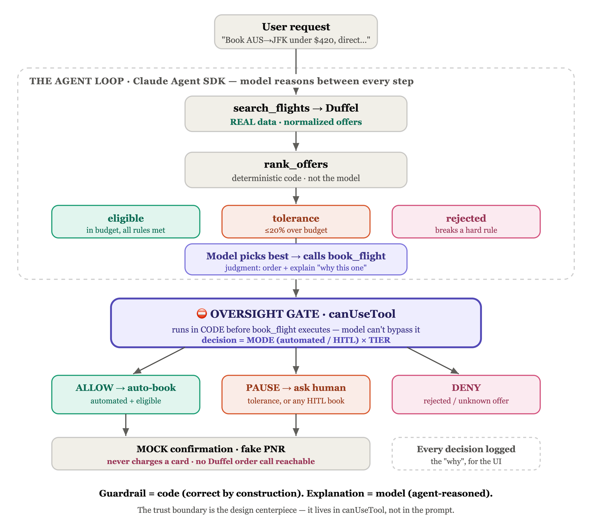
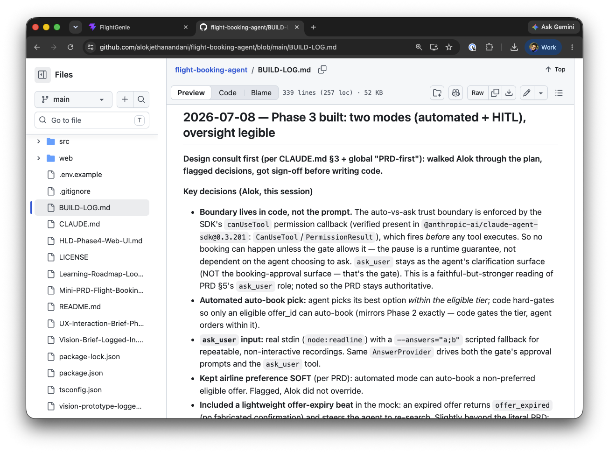
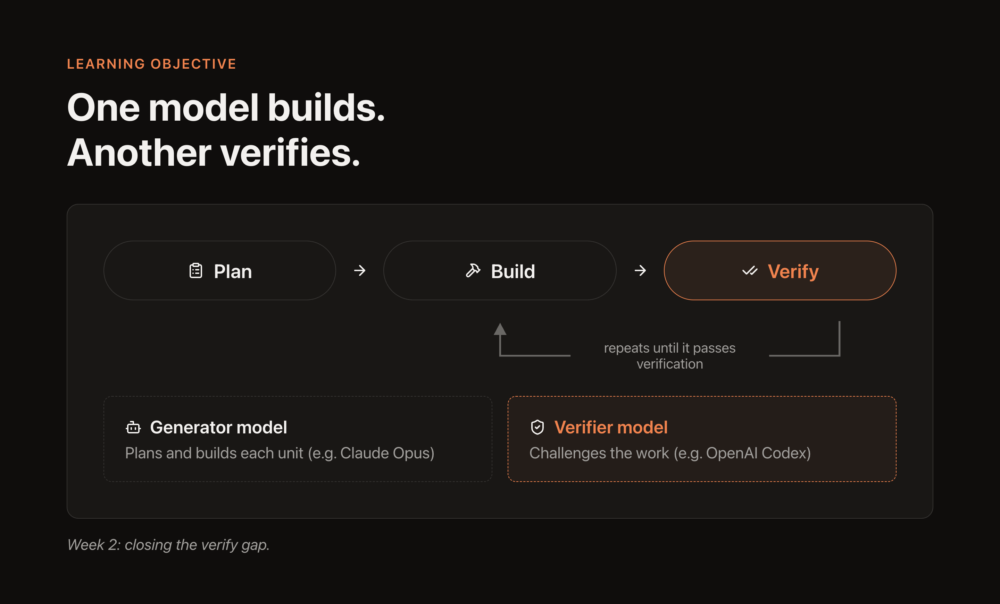

# Week 1: I built my first AI agent — LinkedIn show-and-tell

Two pieces below: a short **teaser post** for the feed, and the **long-form article** it links to. Image/video placeholders are marked `[IMAGE]` / `[VIDEO]` with suggested captions — drop in your screen recordings and moodboard shots before publishing.

---

## PART 1 — Feed teaser (~200 words)

I'm a product designer. Last week I built my first AI agent end-to-end.

Not a Figma prototype *of* an agent. A running one — it does a real flight search across 200+ live fares, ranks them against your constraints, and then does the interesting part: it decides whether to **act on its own** or **stop and ask you first**.

That auto-vs-ask boundary is the thing I've spent 15 years designing *around* in fintech. This week I got to build it, not just spec it.

A few things that surprised me in week 1:

→ My best design tool was a PRD, not a canvas. I used Claude to turn intent into a written spec *before* writing a line of code — that's what gave the agent the context to make good product calls.

→ The trust boundary had to live in **code, not a prompt**. A prompt can be ignored. A permission gate that fires before the agent acts cannot.

→ I can *generate* features fast — but I still can't *automatically verify* them. That's my biggest gap, and exactly where I'm headed next.

Full write-up, including the parts that broke 👇
[link to article]

Genuine question for the builders and designers here: what would you let an agent decide on its own — and what would you never let it touch?

#AgenticAI #ProductDesign #AITools #HumanInTheLoop #BuildingInPublic

---

## PART 2 — Long-form article

### I've spent years drawing the "system acts vs. human decides" line. Last week I built an agent that enforces it.

For 15 years I've designed back-office fintech — the exception queues, the approval steps, the "are you sure?" moments where software hands control back to a person. My through-line has always been *designing for human oversight, not just execution.*

So when I set out to build my first AI agent, I picked a problem that forced that question into the open: a **consumer flight-booking agent**. You give it a trip and your constraints — budget, max stops, total travel time, preferred airlines. It runs a **real** flight search, ranks the results, and runs in two modes:

- **Automated** — find and book the best option that meets every constraint; escalate to me only if the best option breaks a rule.
- **Human-in-the-loop** — always present a preferred pick plus a backup, and let me make the final call.

Search is real (live airline data). **Booking is mocked** — the agent never charges a card or issues a real ticket. The point wasn't to launch a booking company. It was to learn the agent loop and, more importantly, to build my design POV into something running instead of something I merely argue for in interviews.

Here's what week 1 actually taught me.

<video controls>
  <source src="content/recordings/final-hitl-desktop-demo-missing-data-black-bg.mp4" type="video/mp4">
  Your browser does not support the video tag.
</video>

Same agent, two oversight modes. Watch where it acts vs. where it stops.

---

### 1. The best design artifact was a written spec, not a screen

My instinct as a designer is to open a canvas. I resisted it.

Instead, I used Claude to write a **<a href="https://github.com/alokjethanandani/flight-booking-agent/blob/main/Mini-PRD-Flight-Booking-Agent.md" target="_blank">PRD first</a>** — problem, success criteria, scope, non-goals, constraints, a phased build plan. It sounds like process for its own sake. It isn't. That document became the *context* the agent used to make product and design decisions on my behalf. When the spec was sharp, the agent's output was sharp. When the spec was vague, I got vague code.

The lesson: in agentic work, **the prompt that matters most is the one that defines intent** — not the one that asks for a feature. I now think of the PRD as the highest-leverage design deliverable in the whole workflow.

---

### 2. When you're stuck, make the agent do the research

Early on I hit a designer's version of a wall: which component library should this thing be built on? I need date pickers, result cards, filters, form inputs — a lot of surface area.

Instead of guessing, I had the agent research it against my actual requirements. It landed on **<a href="https://ui.shadcn.com/" target="_blank">shadcn/ui</a>** — which turned out to be what my build tool (v0) scaffolds by default anyway, so the "decision" was really a confirmation. But the research surfaced two things I'd have hit the hard way:

- **The primitive layer is shifting.** shadcn sits on a set of headless primitives. The original Radix team has moved on and now builds **Base UI** at MUI; Radix still ships but moves slower, and as of this month shadcn defaults to Base UI for new projects. Good to know *before* you build, not after.
- **The gaps you'll actually feel.** shadcn doesn't ship a real date-range picker or an airport/city autocomplete out of the box — both core to a flight search form. Knowing that up front let me plan to build them on a headless calendar primitive rather than bolting on a second styling system for one component.

The meta-skill here isn't "know every library." It's **knowing how to send the agent to unblock you**, with enough constraints that its answer is actually usable.

---

### 3. The design decision I care about most: irreversibility

Booking a flight on a saved card is close to irreversible. That single fact drove the core product decision.

For v1, the smart default is **human-in-the-loop** — the agent reasons over the options and explains *why* it prefers one, but a person makes the final booking call. Not because the agent can't choose, but because trust is earned before it's delegated. The path I'm designing toward: the agent watches your patterns — the monthly business trip, same city pair, out Sunday morning, back Friday evening — and *earns* the right to automate the repetitive, low-risk bookings while still stopping for anything unusual.

That's the real product thesis: **automation isn't all-or-nothing; it's a boundary you move outward as trust accrues.**

And the technical lesson that made it real: I first tried to enforce this with instructions in the prompt. Wrong. A prompt is a suggestion the model can talk itself out of. The boundary now lives in a **permission gate in code** that fires *before* any booking action runs — so "don't book without asking" isn't a hope, it's a guarantee. That shift, from prompt-as-policy to code-as-policy, was my single biggest mental model change of the week.

---

### 4. Agentic development needs a memory

Working with an agent across many sessions, I kept losing context — what did I decide, and why? The fix was low-tech: a **<a href="https://github.com/alokjethanandani/flight-booking-agent/blob/main/BUILD-LOG.md" target="_blank">build log</a>**. Every session I capture the decisions, the tradeoffs, and the open questions, and commit it to git alongside the code.

It turned git history into the project's memory. Any session — me or the agent — can catch up by reading the log instead of re-deriving the reasoning. If I did this again, I'd set up the build log on day one, not day three.

---

### 5. The honest gap: I can generate faster than I can verify

Here's the part I want to be straight about, because "look how fast I shipped" posts skip it.

The **core trust logic is tested.** There's a real suite — 29 tests — that proves the agent can never reach a live booking call, the mock boundary holding under test, deterministically. That's the one thing I refused to leave to vibes.

But everything I *generate through prompting* — the UI, the feature code — I still verify by hand. Eyeballing it. There's no automated **plan → build → verify** loop yet, and no automation pushing clean commits and pull requests. So my velocity is real on generation and weak on verification, and that asymmetry is exactly the wrong shape: easy to produce, slow to trust.

Naming that gap is the whole reason for week 2.

---

### What I'm trying next

Three experiments, aimed squarely at that verify gap:

1. **Loop engineering** — break the PRD into bite-sized user stories, each with its own plan → build → verify loop, so the agent can plan, build, and *check its own work* on small, testable units instead of one big unverifiable blob.
2. **One model to build, another to test** — generation and verification shouldn't run on the same LLM. The verifier's job is to *challenge* the generator, and a model can't meaningfully challenge its own work.
3. **Defining what makes a *good* loop** — my early hypothesis: loops converge when tasks are small and independently verifiable, and diverge when tasks are large and fuzzy. Keeping tasks inside the "verifiable" zone is the actual engineering.
4. **An external loop I have zero of today** — everything above is about verifying that what I build is *built right*. None of it tells me I'm building the *right thing*. I still need a loop that gets this in front of real users and either validates or kills it, not just a loop that checks my own code.

I'm writing these up as a <a href="https://github.com/alokjethanandani/flight-booking-agent/blob/main/Learning-Roadmap-Loop-Engineering.md" target="_blank">roadmap</a>. If you've run agents in a build-test loop — or paired two models as generator and verifier — I'd genuinely like to compare notes on what held up and what didn't.

*I'm a Lead Product Designer moving from "I prototype products" to "I build agents." This is week 1 of building in public — the wins and the broken parts. Next: closing the gap between how fast I can generate and how fast I can verify.*
