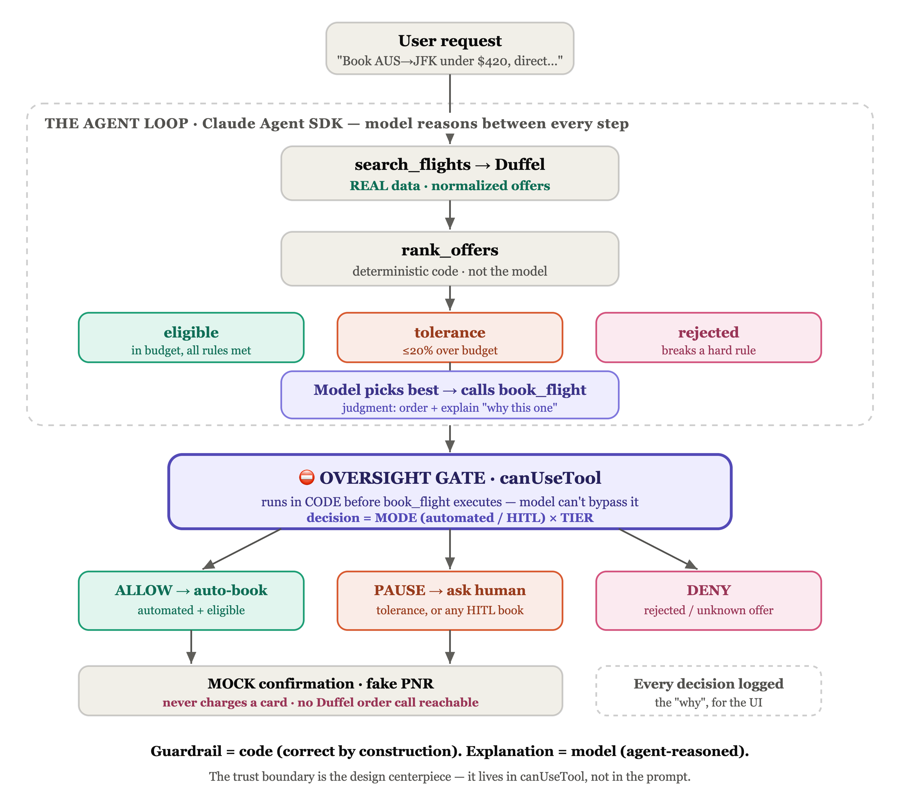

# FlightGenie

I built FlightGenie to test when an AI agent should act on its own and when it should ask for approval. It searches live flights, checks offers against your constraints, and runs in automated or human-in-the-loop mode.

**Booking is always simulated.** The agent never charges a card, issues a ticket, or creates a real passenger reservation.

A portfolio project by [Alok Jethanandani](https://madebyalok.com). [Connect on LinkedIn](https://www.linkedin.com/in/alokjethanandani/).

## The design decision

I put booking permission in a code gate that runs before the booking tool executes. The model recommends an option. The gate checks whether that option can proceed under the selected mode.

The browser shows the plan, flight options, approval requests, and simulated confirmation. This keeps the permission rule consistent across terminal and browser runs.

| Mode | Eligible offer | Over budget within tolerance | Rejected offer |
|---|---|---|---|
| Automated | Simulates booking without approval | Asks for approval | Blocks booking |
| Human-in-the-loop (default) | Asks for approval | Asks for approval | Blocks booking |

Approval cannot override a rejected offer in this version. Change the constraints and search again to reconsider it.

### Demo videos

| [Autobook demo](https://youtu.be/_xD-YL0fAsE) | [Human-in-the-loop demo](https://youtu.be/ewoBK6E12t0) |
|---|---|
| [](https://youtu.be/_xD-YL0fAsE) | [](https://youtu.be/ewoBK6E12t0) |

## Run locally

Use Node 22.12+ and npm for the browser app. The installed Vite packages require Node 20.19+ or 22.12+.

You need an [Anthropic API key](https://console.anthropic.com/) and a [Duffel production API token](https://duffel.com/). Production search returns live multi-airline fares. The booking tool stays simulated regardless of the token.

```bash
git clone https://github.com/alokjethanandani/flight-booking-agent.git
cd flight-booking-agent
npm install
npm install --prefix web
cp .env.example .env
```

Set these values in `.env`:

```dotenv
ANTHROPIC_API_KEY=your_anthropic_api_key
DUFFEL_API_KEY_PROD=your_duffel_production_token
```

`DUFFEL_API_KEY_TEST` is optional for local Duffel checks. The agent's search tool uses the production token. Keep credentials in `.env`, which is excluded from git.

```bash
npm run dev
```

Open [localhost:5173](http://localhost:5173). Vite serves the UI and forwards `/api` requests to Express on port 3001. Model calls and live searches use your provider accounts.

To build the UI and serve it with the API:

```bash
npm run phase4
```

Open [localhost:3001](http://localhost:3001).

## Use the agent

1. Choose manual review or automatic booking in Settings. New sessions start in manual review.
2. Set maximum stops, total duration, passengers, and cabin. Choose an airline preference if needed.
3. Describe the route and dates. Include a USD budget such as "under $600" to set a price cap.
4. Read the plan before the search proceeds. Answer any clarification or approval request.
5. Review the simulated confirmation and the agent's explanation.

The budget parser reads supported price expressions from your request. If it finds no budget, the run has no price cap. Stops and duration come from Settings, so check those fields before searching.

Duration means the sum of the outbound and return flight durations for a round trip. Airline preference is soft by default. Select "Only use this airline" to exclude other carriers before classification.

Dates and other request details depend on model interpretation. Departure and arrival time windows are not enforced by the deterministic constraint gate.

## How the permission gate works

### 1. Classify offers against constraints

[`rank-offers.ts`](src/lib/rank-offers.ts) applies budget, stops, and duration checks in code. The default budget tolerance is 20%.

| Tier | Rule | Booking permission |
|---|---|---|
| `eligible` | Meets the configured hard constraints and budget, if set | Can proceed automatically in automated mode |
| `tolerance` | Up to 20% over budget with the other hard constraints met | Requires approval in both modes |
| `rejected` | Exceeds tolerance, fails a hard constraint, or cannot verify required duration or currency | Blocked in both modes |

The browser extracts the budget with [`parse-budget.ts`](web/src/lib/parse-budget.ts). Full offers stay in [`offer-store.ts`](src/lib/offer-store.ts), so the gate checks stored search data rather than model-generated prices.

Code sorts each tier by price, duration, and airline preference. The model can recommend and explain a choice within the classified results. The result-card order follows the code's default sort.



### 2. Check permission before booking

`book_flight` is excluded from the pre-approved tool list. The SDK calls `canUseTool` in [`oversight.ts`](src/lib/oversight.ts) before execution.

The gate applies the selected mode and waits for approval when required. It records the tier, action, outcome, and reason in a structured decision log. Unknown offer IDs are denied.

### Demo video
[Permission check before booking](https://img.youtube.com/vi/yqJsbcp2f6o/hqdefault.jpg)](https://youtu.be/yqJsbcp2f6o)
[[Permission check before booking](https://img.youtube.com/vi/yqJsbcp2f6o/hqdefault.jpg)](https://youtu.be/yqJsbcp2f6o)

### 3. Return a simulated confirmation

[`book-flight.ts`](src/lib/book-flight.ts) checks offer expiry and returns a fabricated booking record. It imports no Duffel client and makes no order request.

The booking tests check simulated results and expiry behavior. A source scan also checks for Duffel imports and order-call patterns in the booking module. These checks cover the implemented boundary without claiming to prove every future change safe.

## Interaction decisions

I designed the interface around the points where a traveler grants or reviews permission.

| Decision | Reason | Current behavior |
|---|---|---|
| Show a plan before action | Make the selected mode visible before a booking attempt | The plan states when the agent will ask |
| Default to manual review | Let users review recommendations before enabling automation | Every bookable pick needs approval in this mode |
| Use amber for approval requests | Distinguish a budget exception from a failed search | Over-budget offers ask for approval |
| Keep alternatives available | Let users compare offers before deciding | Manual review supports numbered reselection |
| Show search, ranking, and decision steps | Make progress visible during provider latency | The UI renders tool events as steps |
| Label the confirmation as simulated | Make the transaction boundary clear | The receipt states that no ticket or charge exists |

Live impact hints, close-call signals, and direct links from an escalation to a specific setting remain design intent. They are documented in the [interaction brief](UX-Interaction-Brief-Phase4.md).

The cancellation control changes the displayed simulated receipt. It does not cancel a real reservation. Mode changes during a run apply to the next search.

## Architecture

The React app talks to an Express server running the Claude Agent SDK. The tools are `search_flights`, `rank_offers`, `ask_user`, and `book_flight`.

When approval is required, a web `AnswerProvider` sends the question over Server-Sent Events and keeps a promise pending. The browser posts the answer, and the existing permission gate resumes.

| Endpoint | Purpose |
|---|---|
| `POST /api/run` | Start a run and return its ID |
| `GET /api/stream?runId=...` | Stream progress, offers, questions, decisions, and confirmation |
| `POST /api/decision` | Submit an answer for a pending question |

The app uses TypeScript, React, Vite, Tailwind, shadcn/ui, Express, Zod, the Claude Agent SDK, and Duffel's TypeScript client. See the [technical design](HLD-Phase4-Web-UI.md) for the API and event contracts.

This is a local, single-user proof of concept. Run state stays in memory. There are no accounts, authentication, or durable session storage.

## Commands and checks

Run these from the project root:

| Command | Purpose |
|---|---|
| `npm run dev` | Start the API and browser dev servers |
| `npm run phase4` | Build the browser app and serve it with the API |
| `npm run phase0` | Run the agent loop with a dummy tool |
| `npm run phase1` | Search live flights and print results |
| `npm run phase2` | Search, classify, and recommend offers |
| `npm run phase3:hitl` | Run the terminal agent with booking approval |
| `npm run phase3:auto` | Run the terminal agent in automated mode |
| `npm test` | Check classification, simulated booking, and permission routing offline |
| `npm run typecheck` | Check server and terminal TypeScript |
| `npm run build:web` | Check browser TypeScript and build the UI |
| `npm run lint --prefix web` | Lint the browser app |
| `npm run test:tools` | Check the document lint tool |

Phase 3 supports these flags after `--`:

| Flag | Purpose |
|---|---|
| `--scenario=autobook` | Use the automatic-booking demo budget |
| `--scenario=escalate` | Use the escalation demo budget |
| `--offline` | Replace Duffel search with fixed offers. Model calls still run |
| `--answers="y;n;3"` | Supply scripted human replies for a recording |

The terminal entry points use demo trips defined in their source files. Natural-language intake is available in the browser app.

### Auto-commit

`tools/auto-commit.mjs` commits every change in the repo with a generated message. It commits locally only and never pushes.

| Command | Purpose |
|---|---|
| `npm run commit` | Commit all current changes once |
| `npm run commit -- --dry-run` | Show what would be committed and the message, without committing |
| `npm run commit -- -m "Subject"` | Commit once with your own subject line |
| `npm run commit:watch` | Keep running and commit each time the files stop changing. Press Ctrl-C to stop |

Both modes accept these flags after `--`:

| Flag | Purpose |
|---|---|
| `--check` | Run `npm test` and `npm run typecheck` first. Skip the commit if either fails |
| `--interval=N` | Watch mode: seconds between checks for changes. Default 2 |
| `--quiet=N` | Watch mode: seconds the files must stay unchanged before a commit. Default 10 |

The script refuses to commit `.env` files, key files, files over 5 MB, or any added line that looks like a Duffel or Anthropic key. It reports the problem and waits until you fix it.

Watch mode is safe to leave running while you or an agent work in the repo:

- Only one watcher can run at a time.
- A burst of edits lands as one commit, after the files settle.
- It stages into a temporary index, so your own `git add` and `git commit` are not disturbed.
- It never overwrites someone else's commit. If the branch moves while it is committing, it drops its commit and rebuilds on top.
- It pauses while another git command, merge, or rebase is in progress.

Watch mode commits to whichever branch is checked out, including `main`, and every pause in editing becomes a commit. Run it on a separate branch if you want to squash the history later. It does not run git hooks.

## Project status and scope

Phases 0 through 4 are implemented: the agent loop, live search, constraint classification, both permission modes, and the browser UI. Phase 5 covers recordings and publishing drafts. The build log records earlier browser checks against live providers.

Supported trips are one-way and round-trip, with adult passengers. Hotels, cars, multi-city trips, loyalty redemption, seat selection, accounts, and real payment are outside v1.

| Path | Contents |
|---|---|
| `src/phase*.ts` | Terminal entry points |
| `src/lib/` | Search, classification, offer storage, oversight, simulated booking, and tests |
| `src/server/` | API routes, agent orchestration, SSE, and browser answers |
| `web/` | Browser UI |
| `docs/media/` | Recording plan and media assets when available |
| `content/` | Publishing drafts and narration |
| `prompts/` | Design and build instructions used for this project |

## Project documents

- [Product brief](Mini-PRD-Flight-Booking-Agent.md): scope, success criteria, and recorded decisions.
- [Build log](BUILD-LOG.md): implementation history, failures, and verification notes.
- [Technical design](HLD-Phase4-Web-UI.md): browser-to-agent transport and run lifecycle.
- [Interaction brief](UX-Interaction-Brief-Phase4.md): behavior requirements and remaining design intent.
- [Logged-in vision](Vision-Brief-Logged-In.md): static concepts beyond v1.
- [Learning roadmap](Learning-Roadmap-Loop-Engineering.md): planned experiments in build and verification loops.
- [Browser guide](web/README.md): UI development and implementation limits.

## License

MIT. See [LICENSE](LICENSE).
